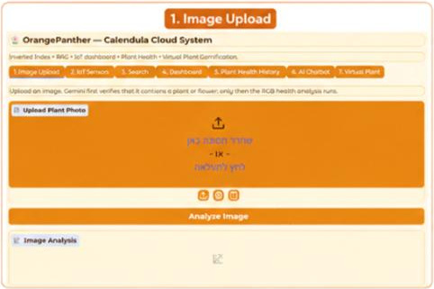
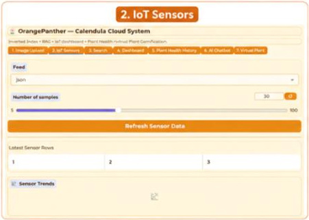
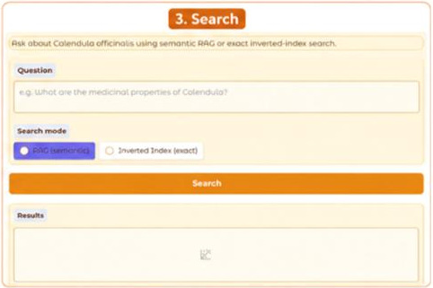
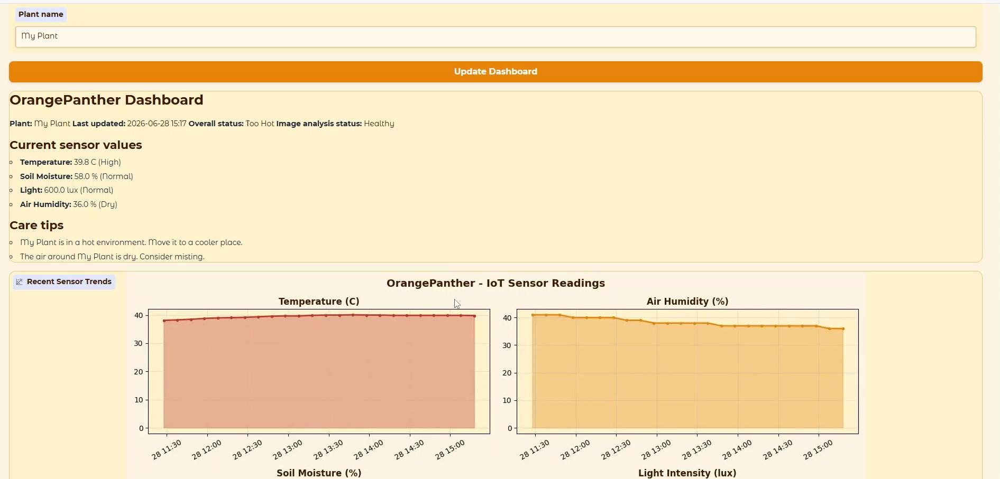
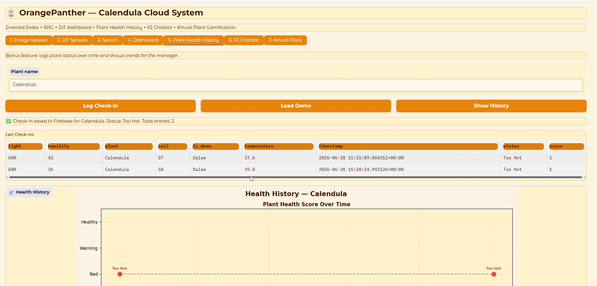
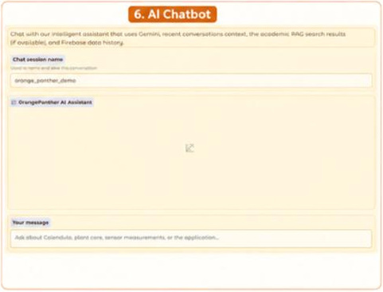
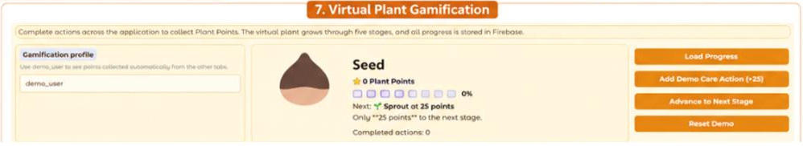

# GreenPanther

GreenPanther is a cloud computing team project for monitoring plant health and exploring research about *Calendula officinalis*. The Gradio interface brings together IoT sensor readings, plant image analysis, and research search.

[Open the final submission in Google Colab](https://colab.research.google.com/drive/1wjukk2Py3b2KFLnIryZpTV46mEOyRA3v?usp=sharing) · [View the notebook on GitHub](GreenPanther.ipynb)

[Read the final project report (PDF)](docs/FinalProjectPanthers.pdf)

## Tech Stack

| Area | Technology and role |
| --- | --- |
| Frontend | Gradio web interface for dashboards, image uploads, and chat |
| Backend | Python notebook in Google Colab for data processing, research retrieval, and plant analysis |
| Database | Firebase Cloud Firestore, with a local-storage fallback |
| Communication | The notebook fetches external data over HTTP and uses SDKs to communicate with Gemini and Firestore. |
| AI and data tools | Gemini, Sentence Transformers (`all-MiniLM-L6-v2`), pypdf, pandas, and Plotly |
| Runtime | Google Colab runs the notebook and launches the Gradio interface. |

## How it works

- **Research search.** The notebook extracts text from articles and PDFs. An inverted index supports keyword lookup, while embeddings support semantic retrieval. Gemini uses retrieved passages to generate answers.
- **Plant monitoring.** The dashboard displays temperature, humidity, soil moisture, and light readings from an external IoT feed. The app also supports image analysis, health check-ins, and watering reminders.
- **Cloud storage.** Firebase Firestore stores sensor readings, health history, chat messages, and search data. The notebook uses local storage when Firebase is unavailable.

## My Contributions

- Published the team's [interactive Colab notebook](GreenPanther.ipynb) and organized the public project showcase.

## Run in Colab

1. Open the notebook in Google Colab.
2. Add `GEMINI_API_KEY` to Colab Secrets and enable notebook access. To use Firestore, add your own service account JSON as `FIREBASE_SERVICE_ACCOUNT`.
3. Run the cells in order and open the Gradio interface from the last cell.

## Screenshots

The screenshots are taken from the project’s recorded demo. The interface is labeled **OrangePanther**.

### Image Upload

Upload a plant photo for AI-assisted analysis.

### IoT Sensors

Load and visualize readings from an external IoT feed.

### Research Search

Search Calendula articles using semantic retrieval or an inverted index.

### Dashboard

Review sensor trends and configure watering reminders.

### Plant Health History

Log plant check-ins and compare health and sensor readings over time.

### AI Chatbot

Ask Gemini questions about Calendula, plant care, and sensor measurements.

### Virtual Plant

Earn points through plant-care activities and track growth across five stages.

